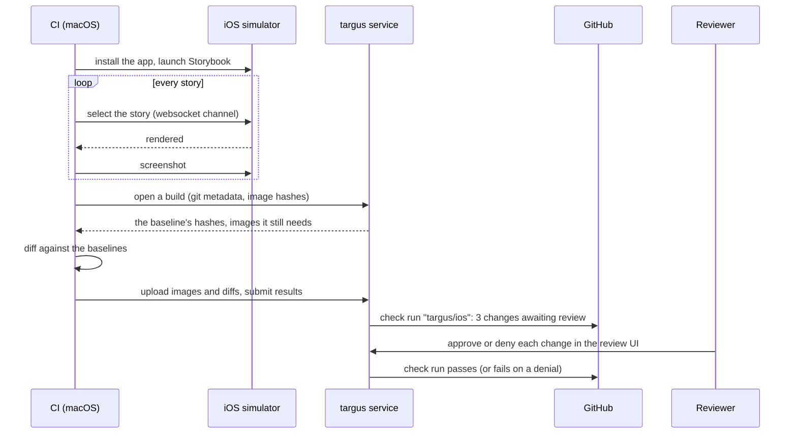

# What targus is

targus is visual review for a React Native app's **on-device Storybook**. On every pull request,
CI renders each story in an iOS simulator, compares the screenshot with the accepted one, and
publishes a GitHub check, `targus/ios`. The check stays pending until someone approves each
visual change in the targus review UI. When the PR merges, the approved screenshots become the new
baseline.

It answers one question on every PR: _which of our components look different now, and did
anybody mean that?_

## What you need

- A React Native app (Expo or bare) with **on-device Storybook** (`@storybook/react-native` 10 or
  later, React 19+, React Native 0.79+).
- **macOS with Xcode** and an iOS simulator, on your laptop and on the CI runner. GitHub Actions'
  hosted macOS runners work, and so does a self-hosted Mac.
- Node 22 or later.
- A targus **project token** for the repository, and the targus GitHub App installed on its
  account or org. Both come from whoever runs your targus service; see
  [Get a project token](quickstart.md#get-a-project-token).

iOS is the only platform in this version. Android is planned.

## How it works

1. **Capture.** `targus run` boots a simulator, installs your app built with Storybook on, and
   drives it over Storybook's websocket channel: it selects each story, waits for it to render
   and settle, and screenshots it twice to make sure it holds still.
2. **Compare.** It asks the targus service for the baseline (the accepted screenshots on the
   commit your branch started from), downloads only the ones whose hash differs, and diffs them
   on the CI machine. Only images the service does not already have are uploaded.
3. **Review.** The service records each story's result and creates the `targus/ios` check run.
   Reviewers open the build from the check, compare old and new side by side, and approve or deny
   each change. Every decision updates the check.
4. **Accept.** When the PR merges, the build on `main` picks up the approvals automatically and
   becomes the baseline for later PRs. Re-pushing a PR does not ask for the same review twice.

## Words you will see

| Term          | Meaning                                                                                                    |
| ------------- | ---------------------------------------------------------------------------------------------------------- |
| **build**     | one `targus run`: every story of one commit on one device                                                  |
| **snapshot**  | one story in one build: its screenshot and its state                                                       |
| **baseline**  | the build a new build is compared with                                                                     |
| `unchanged`   | the screenshot matches the baseline (or differs by less than the threshold, 0.1% of pixels by default)    |
| `changed`     | it differs from the baseline: needs review                                                                 |
| `new`         | the baseline has no such story: needs review                                                               |
| `removed`     | the baseline had the story and this build does not: shown for information                                  |
| `unstable`    | the story never held still between two screenshots: shown, never blocks the check, never becomes the baseline |
| `error`       | the story threw while rendering: fails the build until a later build renders it                            |
| `skipped`     | the story asked to be left out with [`parameters.targus.skip`](../reference/story-parameters.md); never sent to the service |
| **check run** | `targus/ios` on the commit: pending while changes await review, green when all are approved, red on a denial or an error |

## Next

- [Quickstart](quickstart.md): your first capture on your own machine, then your first build.
- [Set up with an AI agent](../prompts/README.md): copy-paste prompts that do the setup for you.
